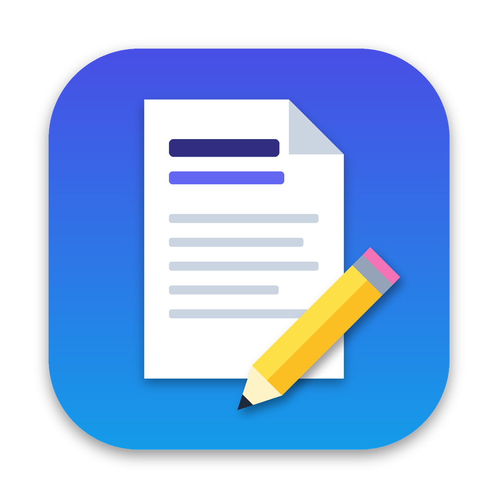

<p align="center"></p>

# Paper Renamer

Eine kleine macOS-App, die wissenschaftliche PDFs automatisch umbenennt – nach dem Schema

```
Autor (Erscheinungsjahr) Titel des Papers.pdf
```

PDF ins Fenster (oder aufs Dock-Symbol) ziehen – fertig. Aus `1706.03762v7.pdf` wird zum Beispiel
`Vaswani et al. (2017) Attention Is All You Need.pdf`, aus `download (3).pdf` wird
`Silver et al. (2016) Mastering the game of Go with deep neural networks and tree search.pdf`.

## Installation

### Variante A: Fertige App herunterladen (ohne Xcode)

1. Auf GitHub im Repository auf **Actions** → **macOS-App bauen** gehen und den neuesten erfolgreichen
   Durchlauf öffnen. Unten bei **Artifacts** die Datei **PaperRenamer-macOS** herunterladen und entpacken.
   (Falls es unter **Releases** eine Version gibt, kannst du die `PaperRenamer.dmg` auch direkt dort laden.)
2. `PaperRenamer.dmg` öffnen und **Paper Renamer** auf **Programme** ziehen.
3. Beim ersten Start meldet macOS, dass die App nicht überprüft werden kann (sie ist nicht bei Apple
   registriert). So öffnest du sie trotzdem:
   - App einmal per Doppelklick öffnen → Meldung schließen.
   - **Systemeinstellungen → Datenschutz & Sicherheit** → ganz unten bei „Paper Renamer“ auf
     **Dennoch öffnen** klicken.

   Alternativ im Terminal:

   ```bash
   xattr -dr com.apple.quarantine "/Applications/Paper Renamer.app"
   ```

### Variante B: Selbst bauen

Voraussetzung sind die Apple Command Line Tools (einmalig):

```bash
xcode-select --install
```

Dann:

```bash
git clone https://github.com/yamaca99-spec/Research-Paper-PDF-Namen.git
```

```bash
cd Research-Paper-PDF-Namen
```

```bash
./scripts/build-app.sh --install
```

Das Skript kompiliert die App, kopiert sie nach `/Applications/Paper Renamer.app` und startet sie.
Eine selbst gebaute App startet ohne Sicherheitsabfrage.

Benötigt wird macOS 13 (Ventura) oder neuer.

## Bedienung

- **PDFs ins Fenster ziehen** – sie werden sofort umbenannt. Mehrere Dateien oder ganze Ordner gehen auch.
- **PDFs aufs Dock-Symbol ziehen** oder im Finder **Rechtsklick → Öffnen mit → Paper Renamer**.
- **Ablage → PDFs auswählen… (⌘O)** öffnet einen Dateidialog.

In der Liste siehst du für jede Datei den neuen und den alten Namen:

| Symbol | Bedeutung |
| --- | --- |
| ✅ grün | Umbenannt, Angaben wurden online bestätigt (DOI, arXiv oder Crossref). |
| 🟠 orange | Umbenannt, aber nur aus der PDF geschätzt – bitte kurz prüfen. |
| ✏️ „Ergänzen…“ | Es fehlte eine Angabe (z. B. das Jahr). Ergänzen und mit ↩︎ umbenennen. |
| ❌ rot | Fehler, z. B. passwortgeschützte PDF oder keine Schreibrechte. |

Pro Zeile gibt es Knöpfe zum **Bearbeiten** (Autor, Jahr, Titel korrigieren), **Im Finder zeigen**,
**PDF öffnen** und **Rückgängig** (stellt den ursprünglichen Dateinamen wieder her).

Beim ersten Umbenennen in „Downloads“, „Dokumente“ oder „Schreibtisch“ fragt macOS eventuell,
ob die App auf diesen Ordner zugreifen darf – bitte erlauben.

## So wird der Name ermittelt

1. **DOI** – aus den eingebetteten PDF-Metadaten (XMP) oder dem Text der ersten Seiten. Die Angaben
   werden bei Crossref bzw. doi.org abgefragt.
2. **arXiv-Nummer** – z. B. `arXiv:1706.03762` am Seitenrand; Abfrage bei arXiv.
   Als Jahr gilt das Jahr der ersten Version.
3. **Titelsuche** – der Titel (größte Schrift oben auf Seite 1) wird bei Crossref gesucht.
4. **Offline-Schätzung** – Titel, Autoren und Jahr (z. B. aus „© 2021“) direkt aus der PDF.

Ein Online-Treffer wird nur übernommen, wenn sein Titel tatsächlich in der PDF vorkommt.
So wird nicht versehentlich der Name eines zitierten Papers verwendet.

**Autoren:** 1 Autor → `Müller`, 2 Autoren → `Müller & Schmidt`, ab 3 Autoren → `Müller et al.`
**Sonderzeichen:** Doppelpunkte im Titel werden zu „ - “, `/ ? * " < > |` werden ersetzt oder entfernt,
damit die Namen auch in iCloud, OneDrive und unter Windows funktionieren. Gibt es den Namen schon,
wird „(2)“ angehängt – es wird nie eine Datei überschrieben.

## Einstellungen (⌘,)

- Autoren-Format: `Müller et al.` (Standard), `Müller et al.` schon ab 2 Autoren, oder nur Erstautor
- Format: `Müller (2021) Titel`, `Müller (2021) - Titel` oder `Müller (2021). Titel`
- Online-Abfrage ein/aus
- Ob nur geschätzte (nicht online bestätigte) Namen sofort angewendet werden

**Datenschutz:** Online gesendet werden nur DOI, arXiv-Nummer bzw. der erkannte Titel an Crossref,
doi.org und arXiv – niemals die PDF selbst. Ohne Online-Abfrage arbeitet die App komplett lokal.

## Für Entwickler

```
Sources/PaperRenamerCore/   Logik: DOI/arXiv-Erkennung, Heuristiken, Online-Abfrage, Dateinamen
Sources/PaperRenamer/       macOS-App (SwiftUI, PDFKit)
Tests/                      Unit-Tests und Test-PDFs
scripts/build-app.sh        baut die .app (optional --universal, --dmg, --install)
scripts/e2e-test.sh         End-to-End-Test mit echten PDFs
```

Tests ausführen (`RUN_NETWORK_TESTS=1` aktiviert zusätzlich echte Abfragen bei Crossref/arXiv):

```bash
swift test
```

Die App hat auch einen Kommandozeilen-Modus, z. B. um vorab nur die Namen anzuzeigen:

```bash
"/Applications/Paper Renamer.app/Contents/MacOS/PaperRenamer" --cli ~/Downloads/*.pdf
```

Mit `--rename` wird tatsächlich umbenannt, mit `--offline` ohne Internet gearbeitet.

Jeder Push baut die App automatisch auf GitHub (siehe `.github/workflows/build.yml`).
Ein Tag wie `v1.0.0` erzeugt zusätzlich ein Release mit der DMG zum Herunterladen.
